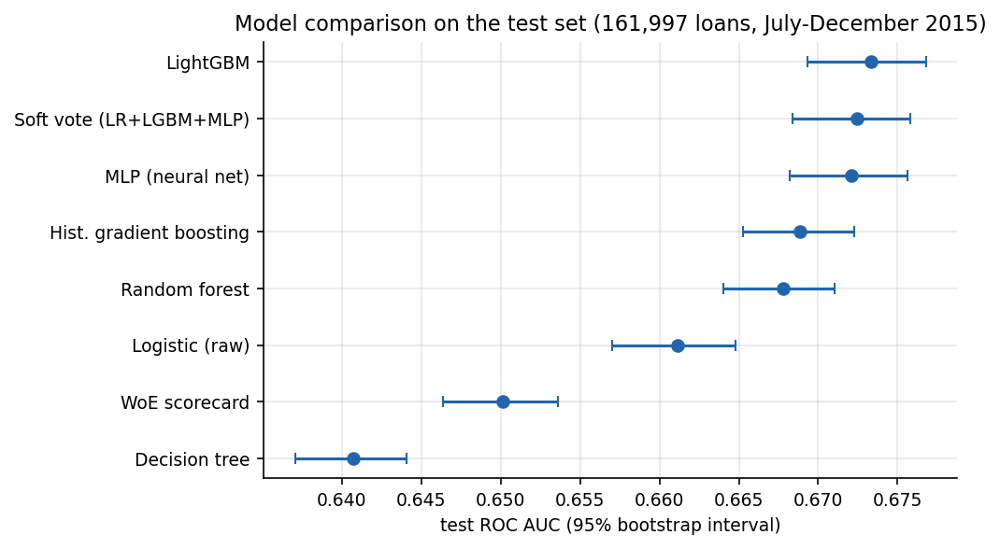
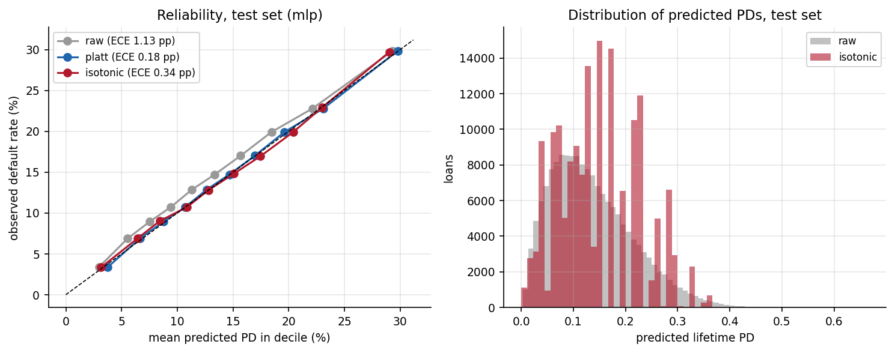
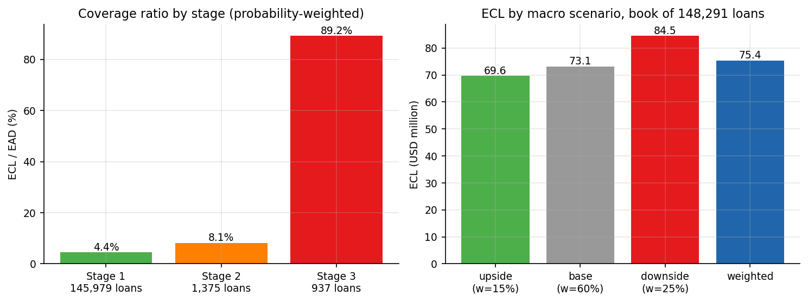
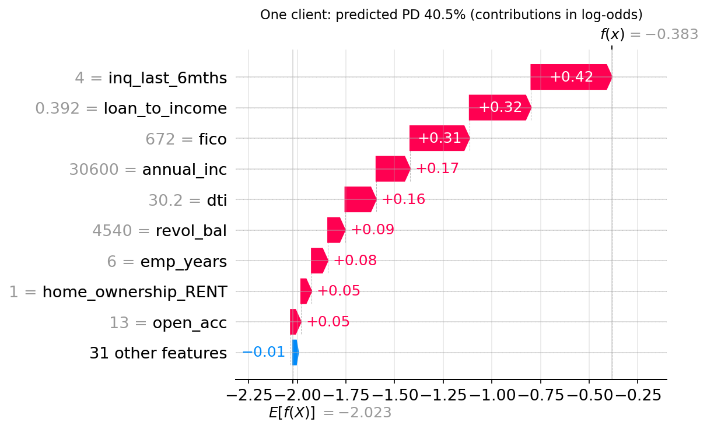

# Credit default prediction with machine learning, from scorecard to IFRS 9 expected credit loss

Which consumer loans will default, how sure can we be, and what does it mean for the loss
allowance and the approval decision? This project trains and compares eight probability-of-default
(PD) models on **620,779 real Lending Club loans**, calibrates and explains the best one, checks
its stability, then turns the PD into an **IFRS 9 expected credit loss** under three macroeconomic
scenarios and into a **cost-based approval cut-off**. Every number comes from the code; the
results are back-tested against what actually happened to the loans.

Report (14 pages): [`report/main.pdf`](report/main.pdf) · Walkthrough notebook (French): [`notebooks/walkthrough.ipynb`](notebooks/walkthrough.ipynb)

## Key results

36-month loans issued 2007-2015, all matured. Time split: train 2007-2014 (337,992 loans),
validation H1 2015 (120,790), test H2 2015 (161,997). Intervals are 95% bootstrap intervals.

| Question | Result |
|---|---|
| Benchmark scorecard (WoE binning, IV filter, logistic, points) | test **AUC 0.650**, Gini 0.300, 9 features kept; FICO has the highest IV (0.139) |
| Best machine-learning model | **LightGBM AUC 0.673** [0.669, 0.677], Gini 0.347, KS 0.250; MLP 0.672 and soft vote 0.672 are statistically tied |
| Is the gain over the scorecard real? | +0.023 AUC, paired bootstrap interval [+0.021, +0.025]; half from raw features, half from non-linearity |
| Calibration on a drifting population | raw PDs too low (13.6% vs 14.7% realised); isotonic recalibration on 2015 H1 cuts the test calibration error from **1.13 to 0.34 pp** |
| What drives the PD (SHAP) | FICO, income, loan purpose, inquiries in 6 months, DTI, loan-to-income; local reason codes for any client |
| Stability | score PSI 0.001 train vs test, rising to 0.071 by 2018Q4 (below 0.10); calibration within 1 pp in every income quintile, region and housing segment |
| IFRS 9 ECL at 30 June 2016 (148,291 loans, USD 1.52 bn) | empirical LGD **89.2%**; ECL **USD 75.4 m = 5.0%** coverage (stage 1: 4.4%, stage 2: 8.1%, stage 3: 89.2%); upside / base / downside 69.6 / 73.1 / 84.5 m |
| Back-test of the ECL | realised loss after the reporting date USD 115.4 m vs 96.6 m expected (base, lifetime): the model **under-predicts by 16%** |
| Approval cut-off | measured costs: refusing a good client 16.5% of the loan, accepting a defaulter 35.9%; Bayes cut-off **PD 31.5%** refuses 2% of applicants and adds 0.9% to realised profit |






## Method in one paragraph

Only application data is used (21 features); Lending Club's own grade and interest rate are kept
out and the sub-grade serves as an external benchmark (AUC 0.681). The scorecard bins each feature
into monotone groups, keeps features with information value of at least 0.02 and fits a logistic
regression on the weights of evidence. Seven other models (logistic on raw features, decision tree,
random forest, histogram gradient boosting, LightGBM, MLP and a soft vote) are tuned by randomised
search with shuffled 5-fold stratified cross-validation, refitted on the whole training period, and
compared on the untouched test period with AUC, Gini, KS, Brier and PR-AUC. The champion (best
validation AUC: the MLP) is recalibrated on the validation period, Platt or isotonic chosen by
cross-fitting. For IFRS 9, the lifetime PD is spread over the loan's life with the empirical timing of
training defaults, multiplied by an empirical LGD and the scheduled balance, discounted at the loan
rate, over 12 months (stage 1) or the remaining life (stage 2); staging uses days past due rebuilt
from the last payment date and a relative PD test. PDs are shifted in logit space with unemployment,
using a regression of US bank consumer charge-offs on unemployment (FRED, 1985-2026).

## Project structure

```
src/
  config.py        paths, dates of the time split, feature lists
  data.py          load the raw file in chunks, default flag, features, time split
  woe.py           monotone binning, WoE / IV, scorecard and points
  models.py        pipelines and search spaces of the 7 machine-learning models
  metrics.py       AUC, Gini, KS, Brier, PR-AUC, bootstrap intervals, calibration error
  calibration.py   Platt scaling and isotonic regression
  stability.py     PSI and performance by segment
  ifrs9.py         timing curve, conditional PDs, annuity EAD, LGD, staging, ECL, scenarios
  threshold.py     cost and profit curves, Bayes cut-off
scripts/
  01_download_data.py      Lending Club (1.7 GB, Hugging Face mirror, CC0) + FRED series
  02_prepare.py            clean table of 36-month loans, sample description       -> figures 1-2
  03_scorecard.py          WoE scorecard and LC sub-grade benchmark                -> figures 3-4
  04_models.py             tuning, test comparison, learning curves (about 25 min) -> figures 5-7
  05_calibration.py        Platt vs isotonic                                       -> figure 8
  06_shap.py               global and local SHAP                                   -> figures 9-11
  07_stability_fairness.py PSI by quarter to 2018, segments                        -> figures 12-13
  08_ifrs9_ecl.py          staging, ECL, scenarios, back-test                      -> figures 14-16
  09_threshold.py          cost-based cut-off                                      -> figure 17
notebooks/walkthrough.ipynb  the story in short cells, in French
tests/test_core.py           21 tests on synthetic data
results/                     every number of the report, as JSON
report/                      LaTeX source (article class), references, compiled PDF, Overleaf zip
```

## Reproduce

```bash
python -m venv .venv && .venv/Scripts/activate      # or source .venv/bin/activate
pip install -r requirements.txt
python run_all.py --download   # download the data (1.7 GB), run everything and the tests (about 35 minutes)
python run_all.py              # same, on data already downloaded
```

The report compiles with `latexmk -pdf main.tex` in `report/`, or by uploading
`report/overleaf_upload.zip` to Overleaf (New project → Upload project).

## Data and limitations

- **Data**: Lending Club accepted loans 2007-2018Q4, public CC0 mirror, no account needed. Larger or
  more representative sets (Freddie Mac loan-level data, Home Credit on Kaggle) need an account and
  were not used. US unsecured peer-to-peer loans, already screened by Lending Club: rejected
  applications are not available (no reject inference), and results do not transfer directly to a
  European bank.
- **Information**: application data only; Lending Club's grade, built with more bureau data, ranks
  better (AUC 0.681). No monthly behavioural data, hence no behavioural score.
- **IFRS 9 simplifications**: default timing and days past due are rebuilt from the last payment
  date, so cured delinquencies are invisible; one timing curve for all loans; no prepayment in the
  EAD; recoveries not discounted; the unemployment link comes from US bank charge-offs and is weak
  (R² 0.08); scenario weights and shocks are assumptions. The relative SICR test moves no loan to
  stage 2 without monthly re-scoring. The back-test shows a 16% under-prediction of the loss.
- **Fairness**: no protected attribute in the data; segments (income, housing, region, employment,
  verification) are a proxy. Applicants without a stated employment length are under-predicted
  (21.5% realised vs 17.3% predicted).
- **Cut-off**: realised profit ignores funding, operating and capital costs and time value.
- **Tuning budget**: searches on 60,000 training loans, 8-20 candidates per model.

## References

Siddiqi (2017); Thomas, Crook & Edelman (2017); Lessmann et al. (2015); Ke et al. (2017, LightGBM);
Breiman (2001); Lundberg & Lee (2017) and Lundberg et al. (2020, SHAP); Platt (1999); Zadrozny &
Elkan (2002); Niculescu-Mizil & Caruana (2005); Elkan (2001); IFRS 9 (IASB, 2014); BCBS (2015).
Full list in [`report/references.bib`](report/references.bib).

Author: Andreas Kyrlakis, MSc in Finance, HEC Lausanne.
